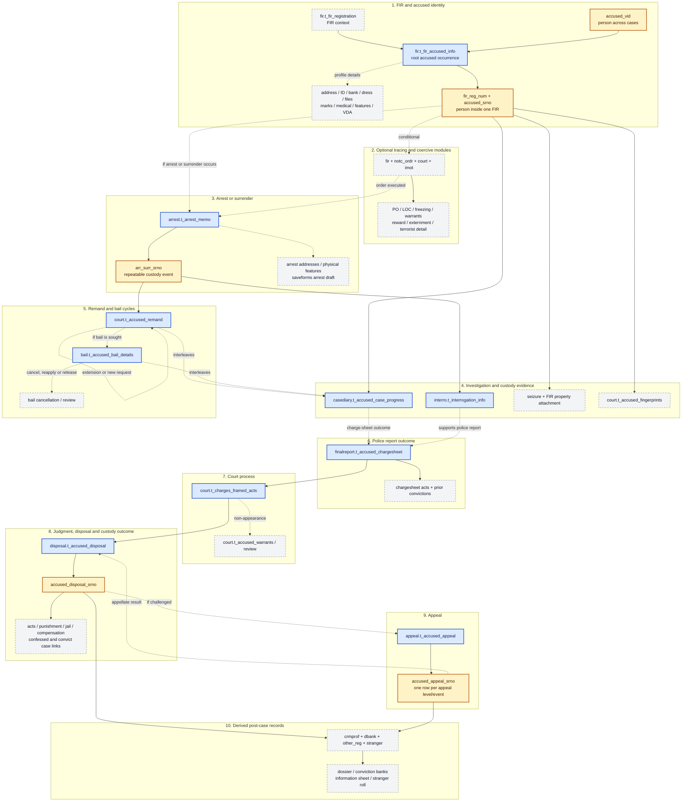
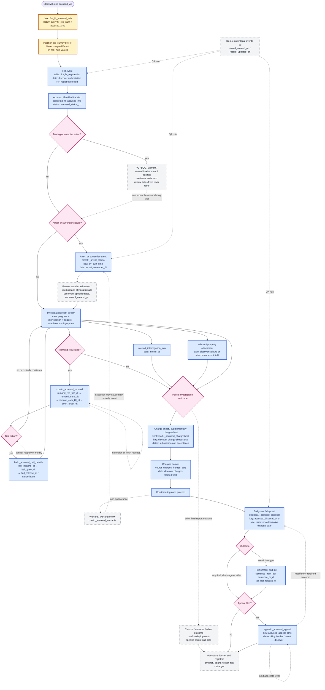

# CCTNS Accused Journey — Mermaid Diagram Set

These diagrams describe the adult FIR-linked accused journey reconstructed from the workbook, the 53 direct `accused_vid` table references, and the verification model. They show lifecycle order, not a claim that every branch occurs in every case.

## Legend

- Solid arrow: normal chronological direction or confirmed parent hand-off.
- Dashed arrow: optional, conditional, derived, or repeatable relationship.
- Blue node: backbone event or anchor table.
- Gold node: identifier/key grain.
- Grey node: optional/detail table or process.
- Pink node: terminal decision or outcome.
- `record_created_on` and `record_updated_on` are audit timestamps, not legal-event timestamps.

## Version 1 — High-level lifecycle (HLL)

Use this version for executive and product discussions. It shows the normal chronological backbone, conditional branches, and the three key grains that prevent cases from being mixed.

```mermaid
flowchart LR
    PERSON([Accused person]) --> PERSONKEY["Person key<br/>accused_vid"]
    PERSONKEY --> FIR["1. FIR and accused identity<br/>FIR module"]
    FIR --> CASEKEY["Case grain<br/>fir_reg_num + accused_srno"]

    CASEKEY -.->|when tracing or coercive action is required| TRACE["2. Tracing and coercive action<br/>FIR + Notice/Order + Court + IMOT"]
    CASEKEY --> CUSTODYQ{"Custody occurs?"}
    TRACE -.->|located or order executed| CUSTODYQ

    CUSTODYQ -->|yes| ARREST["3. Arrest or surrender<br/>Arrest module"]
    ARREST --> ARRESTKEY["Custody-event key<br/>arr_surr_srno"]
    ARRESTKEY --> INVEST["4. Investigation and evidence<br/>Case Diary + Interrogation + Seizure"]
    CUSTODYQ -->|no| INVEST

    INVEST --> REMANDBAIL["5. Remand and bail cycles<br/>Court + Bail modules"]
    REMANDBAIL -.->|repeat, extend, cancel or release| INVEST
    INVEST --> REPORT["6. Charge-sheet or final report<br/>Final Report module"]
    REMANDBAIL --> REPORT

    REPORT --> TRIAL["7. Court process<br/>charges framed / hearings / warrants"]
    TRIAL --> DISPOSAL["8. Judgment and disposal<br/>punishment / jail / release"]
    DISPOSAL --> APPEALQ{"Appeal filed?"}
    APPEALQ -->|yes| APPEAL["9. Appeal<br/>Appeal module"]
    APPEAL -.->|next court level or modified outcome| DISPOSAL
    APPEALQ -->|no| POST["10. Post-case intelligence<br/>dossier / data banks / registers"]
    APPEAL --> POST

    classDef core fill:#dbeafe,stroke:#1d4ed8,color:#172554,stroke-width:2px;
    classDef key fill:#fef3c7,stroke:#b45309,color:#451a03,stroke-width:2px;
    classDef optional fill:#f3f4f6,stroke:#6b7280,color:#111827,stroke-dasharray:5 4;
    classDef outcome fill:#fce7f3,stroke:#be185d,color:#500724,stroke-width:2px;
    class FIR,ARREST,INVEST,REPORT,TRIAL,DISPOSAL,APPEAL core;
    class PERSONKEY,CASEKEY,ARRESTKEY key;
    class TRACE,REMANDBAIL,POST optional;
    class CUSTODYQ,APPEALQ outcome;
```

## Version 2 — Chronological modules, anchor tables and key hand-offs

Use this version for solution design. Each stage names the controlling modules/tables and the key that should travel into the next stage.

## Version 3A — Table-wise map: FIR through police report

This panel contains the 38 direct `accused_vid` tables assigned to stages 1–6. Dotted connectors represent detail or conditional tables; the solid spine represents lifecycle direction.

```mermaid
flowchart TB
    subgraph P1["1. FIR and accused identity — FIR module"]
        direction LR
        F0["fir.t_fir_accused_info"]
        F1["fir.t_fir_accused_address"]
        F2["fir.t_fir_acc_national_id"]
        F3["fir.t_fir_accused_bank_dtls"]
        F4["fir.t_fir_accused_dress"]
        F5["fir.t_fir_accused_files"]
        F6["fir.t_fir_accused_id_marks"]
        F7["fir.t_fir_accused_med_exam"]
        F8["fir.t_fir_accused_phy_feature"]
        F9["fir.t_fir_accused_vda_dtls"]
        F10["fir.t_fir_multi_accused"]
        F0 -.-> F1
        F0 -.-> F2
        F0 -.-> F3
        F0 -.-> F4
        F0 -.-> F5
        F0 -.-> F6
        F0 -.-> F7
        F0 -.-> F8
        F0 -.-> F9
        F0 -.-> F10
    end

    subgraph P2["2. Tracing and coercive branches — optional"]
        direction LR
        TG{"Tracing / order gate"}
        T1["fir.t_accused_procl_offender"]
        T2["notc_ordr.t_fir_lo_circular"]
        T3["notc_ordr.t_freezing_order_accused"]
        T4["court.t_accused_warrants"]
        T5["court.t_accused_warrant_review"]
        T6["court.t_declare_reward"]
        T7["court.t_externment_proposal"]
        T8["court.t_externment_acts"]
        T9["imot.t_imot_addnl_accused_terrorists"]
        T10["imot.t_imot_addn_acc_train_country"]
        TG -.-> T1
        TG -.-> T2
        TG -.-> T3
        TG -.-> T4
        TG -.-> T5
        TG -.-> T6
        TG -.-> T7
        TG -.-> T8
        TG -.-> T9
        TG -.-> T10
    end

    subgraph P3["3. Arrest or surrender — Arrest module"]
        direction LR
        A0["arrest.t_arrest_memo"]
        A1["arrest.t_arrest_addresses"]
        A2["arrest.t_arrest_phy_feature"]
        A3["saveforms.t_arrest_saved"]
        A0 -.-> A1
        A0 -.-> A2
        A0 -.-> A3
    end

    subgraph P4["4. Investigation and custody evidence"]
        direction LR
        I0["casediary.t_accused_case_progress"]
        I1["interro.t_interrogation_info"]
        I2["seizure.t_property_attachment"]
        I3["seizure.t_property_curr_accused"]
        I4["fir.t_fir_property_attachment"]
        I5["court.t_accused_fingerprints"]
        I0 -.-> I1
        I0 -.-> I2
        I0 -.-> I3
        I0 -.-> I4
        I0 -.-> I5
    end

    subgraph P5["5. Remand and bail — repeatable"]
        direction LR
        R0["court.t_accused_remand"]
        B0["bail.t_accused_bail_details"]
        B1["bail.t_acc_bail_cancel_review"]
        B2["kalandra.t_kal_acc_bail_cancel_review"]
        R0 --> B0
        B0 -.-> B1
        B0 -.->|parallel Kalandra branch| B2
    end

    subgraph P6["6. Police final report or charge-sheet"]
        direction LR
        C0["finalreport.t_accused_chargesheet"]
        C1["finalreport.t_chargesheet_acts"]
        C2["finalreport.t_chargesheet_convictions"]
        C0 -.-> C1
        C0 -.-> C2
    end

    F0 -.->|when required| TG
    F0 -.->|if custody occurs| A0
    F0 --> I0
    TG -.->|located or order executed| A0
    A0 --> I0
    A0 -.->|if remand is sought| R0
    I0 -.->|if custody requires court order| R0
    R0 -.->|custody cycle| I0
    I0 -.->|charge-sheet outcome| C0
    R0 -.->|custody context| C0

    classDef anchor fill:#dbeafe,stroke:#1d4ed8,color:#172554,stroke-width:2px;
    classDef detail fill:#f3f4f6,stroke:#6b7280,color:#111827;
    classDef gate fill:#fef3c7,stroke:#b45309,color:#451a03,stroke-width:2px;
    class F0,A0,I0,R0,B0,C0 anchor;
    class TG gate;
    class F1,F2,F3,F4,F5,F6,F7,F8,F9,F10,T1,T2,T3,T4,T5,T6,T7,T8,T9,T10,A1,A2,A3,I1,I2,I3,I4,I5,B1,B2,C1,C2 detail;
```

## Version 3B — Table-wise map: court process through post-case records

This panel contains the remaining 15 direct `accused_vid` tables assigned to stages 7–10.

```mermaid
flowchart TB
    subgraph C7["7. Court process"]
        direction LR
        CF["court.t_charges_framed_acts"]
    end

    subgraph C8["8. Judgment, disposal and custody outcome"]
        direction LR
        D0["disposal.t_accused_disposal"]
        D1["disposal.t_accused_disposal_acts"]
        D2["disposal.t_accused_punishment"]
        D3["disposal.t_accused_jail_details"]
        D4["disposal.t_accused_confessed_cases"]
        D5["disposal.t_accused_convict_cases"]
        D6["disposal.t_court_compensation"]
        D0 -.-> D1
        D0 -.-> D2
        D0 -.-> D3
        D0 -.-> D4
        D0 -.-> D5
        D0 -.-> D6
    end

    subgraph C9["9. Appeal — optional and repeatable"]
        direction LR
        AP["appeal.t_accused_appeal"]
    end

    subgraph C10["10. Derived post-case intelligence and registers"]
        direction LR
        P0["crmprof.t_criminal_dossier"]
        P1["dbank.t_db_drug_peddler_conviction"]
        P2["dbank.t_db_sex_offender_conviction"]
        P3["dbank.t_db_village_convicts"]
        P4["other_reg.t_info_sheet_details"]
        P5["stranger.t_stranger_roll"]
    end

    CF --> D0
    D0 -.->|appeal filed| AP
    AP -.->|result may modify prior outcome| D0
    D0 --> P0
    D0 -.-> P1
    D0 -.-> P2
    D0 -.-> P3
    D0 -.-> P4
    D0 -.-> P5
    AP --> P0

    classDef anchor fill:#dbeafe,stroke:#1d4ed8,color:#172554,stroke-width:2px;
    classDef detail fill:#f3f4f6,stroke:#6b7280,color:#111827;
    classDef appeal fill:#fce7f3,stroke:#be185d,color:#500724,stroke-width:2px;
    class CF,D0,P0 anchor;
    class AP appeal;
    class D1,D2,D3,D4,D5,D6,P1,P2,P3,P4,P5 detail;
```

## Version 4 — Detailed event chronology, branches, dates and identifiers

Use this version when designing the final SQL timeline. Each event node states the preferred parent table, key, and business-date fields that should drive chronological ordering. Fields marked “discover” must be confirmed with Q5–Q8 in `verification_queries.sql`.

## Implementation notes

1. Version 1 is the presentation diagram.
2. Version 2 is the recommended architecture/design diagram.
3. Versions 3A and 3B are the direct-column table inventory. They include all 53 tables from `table_phase_map.csv` exactly once.
4. Version 4 is the blueprint for a typed PostgreSQL `UNION ALL` timeline after date and foreign-key verification.
5. The juvenile `Apprehend` flow and the Kalandra flow are parallel variants. Kalandra appears only where the supplied metadata directly linked it; the juvenile path should be drawn separately when its production tables and keys are confirmed.
