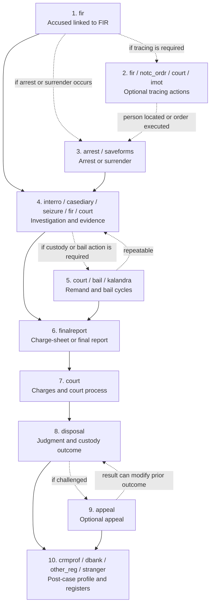

# CCTNS Accused Journey — Module-Wise Explanation

## Executive Summary

- **CCTNS does not store an accused person's journey in one table.** The journey is distributed across multiple schema modules such as `fir`, `arrest`, `interro`, `court`, `bail`, `finalreport`, `disposal`, and `appeal`.
- **Three levels of keys keep the story connected.** `accused_vid` identifies the person across CCTNS; `fir_reg_num + accused_srno` identifies that person's involvement in one FIR; module serial numbers identify repeatable events such as an arrest, remand, bail, disposal, or appeal.
- **The flow is chronological, but not every step is compulsory.** Tracing, arrest, remand, bail, warrant, conviction, appeal, and post-case registers are conditional. Some steps can repeat or return to an earlier part of the journey.
- **The `accused_vid` metadata query is the discovery starting point.** It found 53 direct tables across 18 exact schema modules. Indirect child tables must still be identified through PK/FK relationships.
- **Column meanings are separated by confidence.** A column can be observed in the supplied schema extracts while its uniqueness, declared PK/FK role, coded value, or authority for chronology still requires database verification.

Companion diagram: [CCTNS Accused Journey — Simplified Vertical](CCTNS_Accused_Journey_Simplified_Vertical.mmd)

Database evidence pack: [Concrete Evidence Queries](concrete_evidence_queries.sql)

## The 60-Second Explanation for a Senior

An FIR is registered and a person is added as an accused in `fir.t_fir_accused_info`. That record gives us the person's cross-system identifier, `accused_vid`, and the FIR-specific identifiers, `fir_reg_num` and `accused_srno`.

If the person cannot be found, tracing processes such as a look-out circular, warrant, proclaimed-offender action, reward, externment, or freezing order may be initiated. If the person is arrested or surrenders, `arrest.t_arrest_memo` creates a repeatable custody event identified by `arr_surr_srno`.

The investigation then grows through interrogation, case-diary progress, fingerprints, seizure, and property attachment. If custody is required, remand and bail events can repeat. After investigation, police submit a charge-sheet or another final-report outcome. The court frames charges, conducts the case, and records disposal. A conviction may create punishment and jail records. An appeal may then change or retain that outcome. Finally, dossiers and data-bank records may summarize the person's history.

The central rule is:

> Use `accused_vid` to find the person, `fir_reg_num + accused_srno` to isolate one case, and module-specific serial numbers to separate repeated events.

## Fictional Example Used in This Document

This example is illustrative and does not represent a real person.

| Item | Example value | Meaning |
|---|---:|---|
| Accused name | Ramesh Kumar | Fictional accused |
| `accused_vid` | `900001` | Ramesh across CCTNS and across FIRs |
| `fir_reg_num` | `381010012600999` | One FIR involving Ramesh |
| `accused_srno` | `38101001260099901` | Ramesh's accused occurrence inside that FIR |
| `arr_surr_srno` | `3810100426000999` | One arrest or surrender event |
| `remand_srno` | `3810100126099001` | One remand event |
| `bailer_srno` | `99001` | One bail event |
| `accused_disposal_srno` | `88001` | One court-disposal event for the accused |
| `accused_appeal_srno` | `77001` | One appeal event |

In the example, Ramesh is named in a theft FIR, cannot initially be located, is arrested after a warrant, is interrogated, receives remand, later receives bail, is charge-sheeted, convicted, and then files an appeal.

## Journey at a Glance

## Understanding the Keys Before the Modules

### `accused_vid` — the person-level key

`accused_vid` answers: **Which person is this?**

Ramesh may appear in several FIRs, but his `accused_vid` should continue to identify him across the relevant CCTNS modules. The metadata query found 53 tables that directly contain this column.

Do not use `accused_vid` alone to build one legal-case timeline. Doing so can mix events from different FIRs involving the same person.

### `fir_reg_num + accused_srno` — the case-level key

These keys answer: **Which occurrence of this person in which FIR is this?**

If Ramesh is accused in two different FIRs, the `accused_vid` can be the same while the `fir_reg_num` and normally the accused occurrence differ. The final chronology must therefore be partitioned by FIR.

### Module serial numbers — the event-level keys

These keys answer: **Which repeated event is this?**

- `arr_surr_srno` — one arrest or surrender event
- `interro_srno` — one interrogation event
- `remand_srno` — one remand event
- `bailer_srno` — one bail event
- `accused_disposal_srno` — one accused-disposal event
- `accused_appeal_srno` — one appeal event

These serial numbers are important because an accused can be arrested, remanded, granted bail, have bail cancelled, or appeal more than once.

---

## Module 1 — Exact Module: `fir`

### What happens

The accused is connected to an FIR. This is the root of the FIR-specific journey.

### Example

Police register the theft case. During investigation, Ramesh is identified and entered in `fir.t_fir_accused_info`.

His root record carries:

- `accused_vid = 900001`
- `fir_reg_num = 381010012600999`
- `accused_srno = 38101001260099901`

Profile information such as address, identity document, dress, files, identification marks, medical examination, physical features, bank information, and other details can be attached.

### Main table

`fir.t_fir_accused_info`

- Logical PK: `accused_srno`
- Logical FK/context: `fir_reg_num`
- Cross-module person link: `accused_vid`

### Direct `accused_vid` tables in this stage

- `fir.t_fir_accused_info`
- `fir.t_fir_accused_address`
- `fir.t_fir_acc_national_id`
- `fir.t_fir_accused_bank_dtls`
- `fir.t_fir_accused_dress`
- `fir.t_fir_accused_files`
- `fir.t_fir_accused_id_marks`
- `fir.t_fir_accused_med_exam`
- `fir.t_fir_accused_phy_feature`
- `fir.t_fir_accused_vda_dtls`
- `fir.t_fir_multi_accused`

### Hand-off to the next module

Ramesh is carried forward using `accused_vid`, while `fir_reg_num + accused_srno` keep the events restricted to this theft case.

**Senior takeaway:** this table is the accused journey's FIR-specific starting anchor.

---

## Module 2 — Exact Modules: `fir`, `notc_ordr`, `court`, `imot`

### What happens

These are optional tracing, coercive, intelligence, or restriction actions. They do not occur in every case and do not follow one fixed internal order.

### Example

Ramesh cannot initially be located. Police request a look-out circular, and the court issues a warrant. If he continues avoiding proceedings, proclaimed-offender, reward, externment, or other actions may be recorded.

### Direct `accused_vid` tables

- `fir.t_accused_procl_offender`
- `notc_ordr.t_fir_lo_circular`
- `notc_ordr.t_freezing_order_accused`
- `court.t_accused_warrants`
- `court.t_accused_warrant_review`
- `court.t_declare_reward`
- `court.t_externment_proposal`
- `court.t_externment_acts`
- `imot.t_imot_addnl_accused_terrorists`
- `imot.t_imot_addn_acc_train_country`

### Key connection

The confirmed common discovery key is `accused_vid`. The exact case/event FK combination must be verified from the database constraints and row structure.

### Hand-off to the next module

When Ramesh is located or the warrant is executed, the story can move into arrest. A warrant can also occur later during the court process, so this branch may reappear.

**Senior takeaway:** tracing is a conditional branch, not a mandatory step between FIR and investigation.

---

## Module 3 — Exact Modules: `arrest`, `saveforms`

### What happens

The system records an arrest or voluntary surrender as a custody event.

### Example

Police execute the warrant and arrest Ramesh. CCTNS creates an arrest memo with a new `arr_surr_srno`.

### Main table

`arrest.t_arrest_memo`

- Logical PK: `arr_surr_srno`
- FK/person link: `accused_vid`
- FK/case context: `fir_reg_num + accused_srno`

### Direct `accused_vid` tables

- `arrest.t_arrest_memo`
- `arrest.t_arrest_addresses`
- `arrest.t_arrest_phy_feature`
- `saveforms.t_arrest_saved`

### Hand-off to the next module

Investigation records can follow through `accused_vid + fir_reg_num + accused_srno`. Custody-related events can also retain `arr_surr_srno`.

**Senior takeaway:** `arr_surr_srno` separates one custody event from a possible later re-arrest or surrender.

---

## Module 4 — Exact Modules: `interro`, `casediary`, `seizure`, `fir`, `court`

### What happens

Police collect and record evidence connected to the accused. Several processes can run in parallel.

### Example

Ramesh is interrogated. Police update his case progress, take fingerprints, seize property, and record property attachment.

### Main investigation tables

- `interro.t_interrogation_info`
  - Logical PK: `interro_srno`
  - FK: `accused_vid + fir_reg_num + accused_srno`
- `casediary.t_accused_case_progress`
- `seizure.t_property_attachment`
- `seizure.t_property_curr_accused`
- `fir.t_fir_property_attachment`
- `court.t_accused_fingerprints`
  - Logical PK: `finger_print_srno`
  - FK: `accused_vid + fir_reg_num + accused_srno`

### Hand-off to the next module

If custody is needed, the arrest and case keys lead into remand. Investigation continues even while remand and bail proceedings occur.

**Senior takeaway:** investigation is an event stream, not one database row or one sequential screen.

---

## Module 5 — Exact Modules: `court`, `bail`, `kalandra`

### What happens

The court controls custody through remand, while bail determines whether and under what conditions the accused may be released. These events can repeat.

### Example

Police seek five days of custody for Ramesh. The court grants remand. Ramesh later applies for bail, receives bail, and is released. If he violates conditions, bail cancellation or review may follow.

### Main parent tables

`court.t_accused_remand`

- Logical PK: `remand_srno`
- FK: `fir_reg_num + accused_srno + arr_surr_srno`
- Person link: `accused_vid`

`bail.t_accused_bail_details`

- Logical PK: `bailer_srno`
- FK: `fir_reg_num + accused_srno + arr_surr_srno`
- Person link: `accused_vid`

### Direct `accused_vid` tables

- `court.t_accused_remand`
- `bail.t_accused_bail_details`
- `bail.t_acc_bail_cancel_review`
- `kalandra.t_kal_acc_bail_cancel_review`

### Indirect child example

`court.t_accused_remand_files` does not contain `accused_vid`; it inherits the accused journey through `remand_srno`.

### Hand-off to the next module

Investigation and custody information contribute to the police outcome. Remand or bail does not itself prove that a charge-sheet will be filed.

**Senior takeaway:** remand and bail form a repeatable custody loop inside the larger investigation.

---

## Module 6 — Exact Module: `finalreport`

### What happens

Police complete the investigation and record the investigation outcome. In the example, sufficient evidence exists and a charge-sheet is filed.

### Example

The police charge-sheet Ramesh for the theft offence. Applicable acts and any referenced conviction history are attached.

### Direct `accused_vid` tables

- `finalreport.t_accused_chargesheet`
- `finalreport.t_chargesheet_acts`
- `finalreport.t_chargesheet_convictions`

### Key connection

The direct cross-table person link is `accused_vid`. The logical charge-sheet parent serial and the declared case FKs must be confirmed using the database constraint query.

### Hand-off to the next module

The police report moves the matter into the court process, where charges may be framed.

**Senior takeaway:** this is the police investigation's decision point, not the court's final judgment.

---

## Module 7 — Exact Module: `court`

### What happens

The court handles charges and trial-related process. A warrant may be created again if the accused fails to appear.

### Example

The court frames charges against Ramesh. During trial, if he does not attend a hearing, the court may issue another warrant, potentially leading to another custody event.

### Direct table

- `court.t_charges_framed_acts`

Related court tables already seen in earlier stages include:

- `court.t_accused_warrants`
- `court.t_accused_warrant_review`

### Key connection

`accused_vid` gives the direct person link. `fir_reg_num + accused_srno` should remain in the court hand-off wherever available so that different FIRs are not combined.

### Hand-off to the next module

After hearings and evidence, the case reaches judgment and disposal.

**Senior takeaway:** the `court` schema appears in multiple chronological stages because a schema/module name is not itself a timeline position.

---

## Module 8 — Exact Module: `disposal`

### What happens

The court records the outcome for the accused. Depending on the decision, punishment, jail, compensation, confessed-case, or conviction-case information may follow.

### Example

Ramesh is convicted. CCTNS creates an accused-disposal event with `accused_disposal_srno = 88001`. Punishment and jail information are linked to the outcome.

### Main table

`disposal.t_accused_disposal`

- Logical PK: `accused_disposal_srno`
- FK/person link: `accused_vid`
- FK/case context: `fir_reg_num + accused_srno`

### Direct `accused_vid` tables

- `disposal.t_accused_disposal`
- `disposal.t_accused_disposal_acts`
- `disposal.t_accused_punishment`
- `disposal.t_accused_jail_details`
- `disposal.t_accused_confessed_cases`
- `disposal.t_accused_convict_cases`
- `disposal.t_court_compensation`

### Detail joins

- `accused_disposal_srno` connects the accused disposal to disposal acts and punishment.
- `fir_reg_num + accused_srno` retains the case context for jail or other outcome records where available.
- `accused_appeal_srno` may appear in punishment records when an appellate outcome changes punishment.

### Hand-off to the next module

If the outcome is challenged, the journey moves to appeal. Otherwise, the court-level legal journey can end here before derived post-case records are updated.

**Senior takeaway:** disposal records the outcome for one court level; it is not always the absolute end because appeal can change it.

---

## Module 9 — Exact Module: `appeal`

### What happens

An accused or another authorized party challenges the court outcome. Appeals can occur at more than one court level.

### Example

Ramesh files an appeal. The appellate court retains the conviction but reduces the punishment. A new appeal event is identified by `accused_appeal_srno = 77001`.

### Main table

`appeal.t_accused_appeal`

- Logical PK: `accused_appeal_srno`
- FK/person link: `accused_vid`
- FK/case context: `fir_reg_num + accused_srno`

### Indirect child example

`appeal.t_accused_appeal_acts` is linked through `accused_appeal_srno`. It is not returned by the direct `accused_vid` metadata query.

### Hand-off

The appeal result can retain or modify the earlier disposal or punishment. A later appeal can create another appeal event.

**Senior takeaway:** appeal is optional and repeatable; the previous judgment remains part of history rather than being overwritten conceptually.

---

## Module 10 — Exact Modules: `crmprof`, `dbank`, `other_reg`, `stranger`

### What happens

These modules reuse or consolidate the person's history for policing, intelligence, or register purposes. They are not new court milestones.

### Example

After Ramesh's conviction and appeal result, his history may appear in a criminal dossier or an applicable conviction data bank.

### Direct `accused_vid` tables

- `crmprof.t_criminal_dossier`
- `dbank.t_db_drug_peddler_conviction`
- `dbank.t_db_sex_offender_conviction`
- `dbank.t_db_village_convicts`
- `other_reg.t_info_sheet_details`
- `stranger.t_stranger_roll`

### Key connection

The primary cross-module discovery link is `accused_vid`. Source FIR and case identifiers should be retained where the tables provide them.

**Senior takeaway:** these records summarize or reuse history; they should not be placed between judgment and appeal as if they were legal proceedings.

---

## Important Column Dictionary — Concrete vs Assumed Meaning

This section distinguishes what the supplied metadata and lookup extracts actually show from what the current journey model infers. That distinction matters because a familiar-looking column name does not by itself prove a primary key, foreign key, unique constraint, or business rule.

### Confidence legend

| Label | How to read it |
|---|---|
| **Concrete / observed** | The exact column was seen in the supplied metadata or lookup extracts. Its description is limited to what the name, sample structure, or attached lookup reference supports. |
| **Logical / assumed** | The meaning or relationship is a reasonable working interpretation used to connect the journey, but it has not yet been proven from declared database constraints or production data. |
| **Verify** | Run the relevant metadata or data query before presenting the statement as a confirmed CCTNS rule. |

### 1. Person and FIR identity columns

| Column | Important locations | Concrete / observed meaning | Logical / assumed meaning and verification needed | How to use it |
|---|---|---|---|---|
| `accused_vid` | `fir.t_fir_accused_info` and 52 other direct tables returned by the metadata search | An accused identifier is physically present or copied in 53 direct tables across 18 schemas. | It is assumed to be the stable person-level identifier across FIRs and modules. Verify whether it is unique in a person master and whether every occurrence is a declared FK. | Start with it to discover all records for one person; do not use it alone to construct one case timeline. |
| `fir_reg_num` | FIR, arrest, interrogation, remand, bail, disposal, appeal, and other case tables | A common FIR registration reference appears in records belonging to multiple modules. | It is assumed to identify the same FIR consistently and to form the main case boundary. Verify datatype consistency, leading-zero handling, and its declared parent/FK. | Partition a person's history by FIR before ordering events. |
| `accused_srno` | `fir.t_fir_accused_info` and downstream module tables | A serial identifying an accused occurrence is stored with case records. | It is assumed to identify one accused entry in an FIR. Verify whether it is globally unique or unique only with `fir_reg_num` and possibly `lang_cd`. | Use with `fir_reg_num` to keep two accused in the same FIR—and the same person in two FIRs—separate. |
| `fir_accused_srno` | `arrest.t_arrest_memo` and related records | A separately named reference to an FIR accused serial is present in the arrest data. | It probably copies or references the FIR accused record, but it must be reconciled with `accused_srno`; do not assume that the two fields are interchangeable. | Compare both columns for a sample case and use the confirmed relationship in joins. |
| `accused_srno_migr` / `fir_accused_srno_migr` | FIR and downstream extracts | The `_migr` suffix is present on legacy/migration-oriented serial fields. | They are assumed to preserve identifiers from a migrated or source system. Verify the migration mapping and whether these values are populated only for legacy records. | Use for reconciliation and migration lineage, not as the current operational key unless confirmed. |
| `lang_cd` | Many CCTNS tables | A language code exists; the extracts associate it with the `OFFCL_LANG` lookup. | In multilingual tables it may be part of a composite PK or select a translated row. Verify actual constraints and the meaning of values such as `99`. | Include it when the same business record has multiple language rows; do not mistake translations for duplicate events. |

**Example:** `accused_vid = 900001` may find Ramesh in several FIRs. `fir_reg_num = 381010012600999` plus the correct accused serial narrows the analysis to Ramesh's occurrence in this one fictional FIR.

### 2. Arrest and surrender columns

| Column | Important locations | Concrete / observed meaning | Logical / assumed meaning and verification needed | How to use it |
|---|---|---|---|---|
| `arr_surr_srno` | `arrest.t_arrest_memo`; also copied into FIR, remand, bail, and supporting tables | A shared arrest/surrender serial is present across custody-related modules. | It is treated as the event-level identifier for one arrest or surrender. Verify its PK table, uniqueness scope, and whether one accused can have multiple values. | Join a specific arrest/surrender event to its details, remand, and bail records. |
| `arrest_type_cd` | FIR accused and arrest data | A coded arrest/surrender type is present; the extract points to the `ARR_SURR_TYPE` lookup. | The exact values—such as arrested, surrendered, or another category—must be decoded from the referenced master. | Use the decoded value to describe how custody began. |
| `arrest_surrender_dt` | `arrest.t_arrest_memo` | A business date/time for the arrest or surrender is stored in the arrest memo. | It is the preferred candidate for the arrest milestone, but authority must be checked against copied arrest dates elsewhere. | Use as the arrest-event timestamp after source precedence is confirmed. |
| `arrest_surr_dt` | `fir.t_fir_accused_info` | An arrest/surrender date is also stored on the FIR accused record. | It is likely a summary or copied value. Verify whether it is updated from the arrest module and whether historical re-arrests can overwrite it. | Use as a cross-check, not automatically as the authoritative event time. |
| `arrest_dt` | `interro.t_interrogation_info` | The interrogation record contains an arrest date field. | It is likely copied context used during interrogation rather than the arrest transaction itself. | Do not create a second arrest event from this field without matching `arr_surr_srno` or the arrest memo. |
| `is_arr_by_warrnt` | `arrest.t_arrest_memo` | A flag states whether the arrest was by warrant. | Null, false, and legacy-value behavior must be checked. The spelling is an exact database name. | Use with `warrant_num` and `warrant_issue_dt` to explain the path from warrant to arrest. |
| `warrant_num` / `warrant_issue_dt` | `arrest.t_arrest_memo` | Warrant reference and issue date fields are available on the arrest record. | Verify whether they refer directly to `court.t_warrant` and whether the number is unique only within a court or year. | Describe the legal authority for the arrest, not a separate accused identity. |
| `is_re_arrested` | FIR accused and arrest records | A re-arrest indicator exists. | Verify whether null means “no,” “unknown,” or “not applicable,” and whether the flag is maintained consistently. | Use as a signal that another custody cycle may exist. |
| `re_arr_surr_srno` | FIR accused and arrest records | A second arrest/surrender serial field exists for re-arrest handling. | It likely links one custody event to a re-arrest event, but the direction of that link must be verified. | Build a re-arrest chain only after checking sample rows and constraints. |

**Example:** Ramesh's `arr_surr_srno = 3810100426000999` should identify one custody event. If he is arrested again, the same `accused_vid` and FIR context may have another arrest serial rather than overwriting the first event.

### 3. Interrogation and investigation columns

| Column | Important locations | Concrete / observed meaning | Logical / assumed meaning and verification needed | How to use it |
|---|---|---|---|---|
| `interro_srno` | `interro.t_interrogation_info` and its detail tables | A serial number identifies an interrogation record and appears on interrogation-related children. | It is treated as the logical interrogation-event PK. Verify its declared PK and whether `lang_cd` participates. | Group all detail rows belonging to one interrogation event. |
| `interro_dt` | `interro.t_interrogation_info` | A business date for interrogation is stored. | Verify datatype/time-zone precision and whether corrections create a new row or update the old one. | Place the interrogation in the legal timeline. |
| `acc_search_dt` | `interro.t_interrogation_info` | An accused-search date is stored in the interrogation information. | The exact operational event represented by “search” needs domain confirmation. | Treat it as investigation context unless the business team confirms it as a separate milestone. |
| `jail_last_release_dt` | Interrogation and disposal/jail context | A last jail-release date is carried in accused-related records. | It may be historical profile context rather than the release date for the current FIR. Verify its FIR scope and source. | Do not place it in the current-case timeline until it is tied to the correct jail/custody event. |

### 4. Remand columns

| Column | Important locations | Concrete / observed meaning | Logical / assumed meaning and verification needed | How to use it |
|---|---|---|---|---|
| `remand_srno` | `court.t_accused_remand`; referenced by `court.t_accused_remand_files` | A remand serial links the remand parent to supporting files. | It is treated as the logical PK for one remand request/order cycle. Verify the declared PK and whether extensions create new remand rows. | Separate repeated remand events and attach only their own files. |
| `remand_type` | `court.t_accused_remand` | A remand-type field is stored. | Its exact categories and whether it is a code or free text need verification. | Decode before describing police, judicial, transit, or another remand type. |
| `remand_days_req` | `court.t_accused_remand` | Number of remand days requested is stored. | Verify unit, inclusivity, and null/zero conventions. | Compare the investigating agency's request with the court's sanction. |
| `remand_days_sanc` | `court.t_accused_remand` | Number of remand days sanctioned is stored. | Verify whether it is the original order only or includes later extension days. | Report what the court granted, separately from what was requested. |
| `remand_req_frm_dt` / `remand_req_to_dt` | `court.t_accused_remand` | Requested remand start and end dates are stored. | Verify whether both endpoints are inclusive and whether they represent a proposed period. | Show the requested custody window, not automatically the approved window. |
| `remand_sanc_dt` | `court.t_accused_remand` | A remand sanction date is stored. | Confirm whether this is the order date or the start of sanctioned custody. | Use as a court decision milestone after confirming the business rule. |
| `court_order_no` / `court_order_dt` | Remand and other court-linked records | Court order reference and date fields are present. | Verify uniqueness scope and whether the same order is copied into multiple rows. | Link the remand/bail outcome to its court order without treating copied rows as new orders. |
| `remand_extn_days` / `remand_extn_till_dt` | `court.t_accused_remand` | Extension duration and extension-until date fields are stored. | Verify whether repeated extensions update these fields or generate separate rows. | Represent an extension as part of or following the original remand according to the confirmed model. |
| `remand_status` | `court.t_accused_remand` | A remand status field exists. | Its allowed values and lifecycle transitions are not established by the supplied extract. | Decode before filtering active, completed, rejected, or cancelled remands. |

### 5. Bail columns

| Column | Important locations | Concrete / observed meaning | Logical / assumed meaning and verification needed | How to use it |
|---|---|---|---|---|
| `bailer_srno` | `bail.t_accused_bail_details`; referenced by bail review records | A serial identifies a bail detail row and connects it to review history. | Despite the name, it is treated as a bail-event serial—not automatically the identifier of a person furnishing bail. Verify the declared PK and data dictionary definition. | Separate multiple bail applications/orders for the same accused and arrest event. |
| `bail_hearing_dt` | `bail.t_accused_bail_details` | Bail hearing date is stored. | Verify whether multiple hearings create multiple rows or update one record. | Use for the hearing milestone, not the grant or release milestone. |
| `bail_grant_dt` | `bail.t_accused_bail_details` | Date on which bail was granted is stored. | Verify treatment of interim bail and later modification. | Record the court's bail decision. |
| `bail_release_dt` | `bail.t_accused_bail_details` | Actual release date is stored separately from grant date. | Verify source and whether it can precede/follow validity dates because of data corrections. | Use to show when custody actually ended; do not substitute `bail_grant_dt`. |
| `bail_start_dt` / `bail_end_dt` | `bail.t_accused_bail_details` | Bail validity start and end fields are available. | Verify whether an absent end date means continuing bail. | Describe the validity window, not necessarily the hearing or physical release time. |
| `bail_status` | `bail.t_accused_bail_details` | A bail status value is stored. | The code/value domain and transitions need verification. | Decode before reporting pending, granted, rejected, cancelled, or completed states. |
| `is_bail_cancelled` | `bail.t_accused_bail_details` | A cancellation indicator exists. | Verify null behavior and consistency with `bail_status`. | Use with cancellation reason/date rather than alone. |
| `bail_cancel_reason` / `bail_cancelled_on` | `bail.t_accused_bail_details` | Cancellation reason and date fields are stored. | Verify whether each cancellation creates a review row and whether reinstatement is possible. | Place a cancellation after the grant/release event and preserve the original bail history. |
| `bail_review_srno` / `prev_review_srno` | `bail.t_acc_bail_cancel_review` | A review serial and a previous-review serial support review iterations. | They are assumed to form a version/history chain. Verify the direction and whether `prev_review_srno` can point across bail events. | Order repeated cancellation reviews without overwriting earlier decisions. |

**Example:** if bail is granted on June 10 but Ramesh is released on June 12, the chronology must keep both dates. Grant is the legal decision; release is the custody event.

### 6. Final report and court-process columns

| Column | Important locations | Concrete / observed meaning | Logical / assumed meaning and verification needed | How to use it |
|---|---|---|---|---|
| `chargesheet_srno` | Currently shown in the Mermaid model for `finalreport.t_accused_chargesheet` | The present evidence set has not yet confirmed this exact column as the table's declared key. | It is an assumed logical name/role and must be checked through Q6/Q7 before use. | Do not build production joins on this field until the actual column and constraint are returned from the database. |
| `courtcase_num` | Disposal and appeal records | A court-case number is stored in post-investigation records. | Verify its formatting and uniqueness by court establishment, case type, and year. | Use as court context; retain the FIR keys because one identifier should not silently replace the other. |
| `court_estbl_cd` / `court_name_cd` | `appeal.t_accused_appeal` and court-linked records | Codes identify the relevant court establishment/name. | Exact values require master-table decoding; uniqueness of `courtcase_num` may depend on them. | Qualify the court-case reference and identify the appellate forum. |

### 7. Disposal, punishment, jail, and appeal columns

| Column | Important locations | Concrete / observed meaning | Logical / assumed meaning and verification needed | How to use it |
|---|---|---|---|---|
| `accused_disposal_srno` | `disposal.t_accused_disposal`; copied to disposal acts and punishment | An accused-specific disposal serial links the outcome to its supporting detail rows. | It is treated as the logical PK of one accused's disposal at one court stage. Verify the declared PK and repeatability by court level. | Anchor the judgment/outcome and its acts or punishment rows. |
| `disposal_srno` | `disposal.t_accused_disposal` and detail context | A broader disposal serial is stored separately from the accused-specific serial. | It likely identifies the parent case-disposal event. Verify its parent table and cardinality to `accused_disposal_srno`. | Use the accused-specific key for one person's result and the parent key for the common case result, once confirmed. |
| `disposal_type_cd` | Disposal and appeal records | A coded disposal type exists; the supplied extract points to `ACC_DISPSL_TTP`. | Exact codes for conviction, acquittal, discharge, and other outcomes must be read from the lookup—not inferred from numeric values. | Decode to state the legal outcome at that court level. |
| `aquittal_reas_cd` | `disposal.t_accused_disposal` | A coded acquittal-reason field exists; `aquittal` is the exact database spelling. | The applicable lookup and whether it is valid only for acquittal outcomes must be confirmed. | Report an acquittal reason only when the disposal type supports it. |
| `punishment_type_cd` | Disposal, punishment, and appeal records | A coded punishment type is carried in outcome-related tables. | Exact types and precedence across duplicated copies require lookup and source-authority checks. | Decode the punishment; use the detailed punishment row for duration/amount when available. |
| `acc_punish_srno` | `disposal.t_accused_punishment` | A serial identifies a punishment detail record. | It is treated as the logical PK of one punishment component. Verify whether one disposal can have several concurrent components. | Preserve imprisonment, fine, bond, or other components as separate rows where applicable. |
| `punish_yrs` / `punish_mnth` / `punish_days` | `disposal.t_accused_punishment` | Punishment duration is split into year, month, and day components. | Verify null-versus-zero rules and whether terms are concurrent or consecutive. | Combine only for display; preserve original components for legal accuracy. |
| `fine_amount` / `bond_*` | `disposal.t_accused_punishment` | Monetary fine and bond-related fields exist. | Currency, null behavior, and applicability by punishment type need confirmation. | Report financial conditions separately from imprisonment duration. |
| `acc_jail_srno` | `disposal.t_accused_jail_details` | A serial identifies an accused jail-detail row. | It is treated as the logical jail-detail PK. Verify relationship to custody episodes and disposal/punishment rows. | Track jail information without assuming it represents the only custody period. |
| `eprison_id` / `jail_cd` | `disposal.t_accused_jail_details` | An ePrison identifier and jail code are stored. | Verify the external-system key format and decode `jail_cd`. | Link the CCTNS outcome to the appropriate prison/jail record when permitted. |
| `is_appeal_preferred` | `disposal.t_accused_disposal` | An indicator records whether an appeal was preferred. | Verify whether it is derived from appeal rows or manually maintained and whether null means unknown. | Use as a signal; confirm the appeal by locating an actual appeal record. |
| `appeal_party_cd` | Disposal and appeal records | A code identifies the party associated with the appeal. | Decode the master values before stating whether the accused, state, complainant, or another party appealed. | Explain who initiated the appellate step. |
| `accused_appeal_srno` | `appeal.t_accused_appeal`; referenced by appeal acts and punishment | An accused-specific appeal serial links the appeal to its detail rows. | It is treated as the logical PK of one appeal event. Verify declared PK and how later appeal levels relate to earlier ones. | Separate district/high/supreme or repeated appeal events rather than overwriting the first appeal. |
| `appeal_srno` | `appeal.t_accused_appeal` | A broader appeal serial is stored separately from the accused-specific appeal serial. | It likely references a parent case-level appeal. Verify the parent table and one-to-many relationship. | Use only after confirming how it groups several accused under one appeal. |
| `appeal_result_cd` | `appeal.t_accused_appeal` | A coded appeal result exists; the supplied extract points to `APPEAL_RSLT_TYP`. | Exact outcomes must be decoded from the master lookup. | State whether the prior result was upheld, changed, remanded, or otherwise disposed only after decoding. |
| `is_punishment_retained` | `appeal.t_accused_appeal` | A flag records whether punishment was retained. | Verify whether it covers only full retention or also partial modification, and reconcile it with detailed appeal punishment fields. | Use as a summary flag, not a substitute for the complete appellate result. |

### 8. Audit fields and naming conventions

| Column or pattern | Concrete / observed meaning | Important caution |
|---|---|---|
| `record_status` | A row-lifecycle/status field appears in many extracts. | Its codes must be verified. It is a technical/business row state and should not be interpreted as “convicted,” “acquitted,” or another legal outcome. |
| `record_created_on` | Timestamp showing when a row was created in the application/database. | It may be later than the real-world event because of delayed entry or migration. Do not use it as the default legal-event date. |
| `record_updated_on` | Timestamp showing the most recent row update. | Sorting by it orders edits, not the accused journey. A correction can make an old event appear recent. |
| `record_sync_on` | Timestamp associated with synchronization between systems/nodes. | It is a technical movement timestamp and is not evidence that the legal event happened then. |
| `*_srno` | Naming convention for serial-number fields. | A serial number is not automatically a declared PK, nor is the same-named field automatically a declared FK in another table. Confirm with Q7. |
| `*_cd` | Naming convention for coded fields linked or expected to link to master/reference data. | Never infer a code's meaning from the number alone. Join to the exact lookup/master and retain both code and readable value. |
| `is_*` | Naming convention generally used for flags/booleans. | Check datatype and the distinction among `true`, `false`, `NULL`, `0`, and legacy values before filtering. |
| `*_migr` | Naming convention generally associated with migrated identifiers or values. | Preserve for lineage and reconciliation, but do not replace current keys with it without a documented migration rule. |

### Column precedence for a trustworthy chronology

When the same event date appears in several modules, prefer the field recorded by the module that owns the event, subject to database verification:

1. Arrest/surrender: prefer `arrest.t_arrest_memo.arrest_surrender_dt`; compare with FIR and interrogation copies.
2. Interrogation: prefer `interro.t_interrogation_info.interro_dt`.
3. Remand: use request, sanction, order, and extension dates for their separate meanings; do not collapse them into one date.
4. Bail: keep hearing, grant, release, validity, and cancellation dates as separate milestones.
5. Disposal and appeal: use the confirmed judgment/disposal and appeal-result business dates from their owning tables; do not substitute audit timestamps.

**Senior takeaway:** the key tells us *which record belongs to whom*; the business date tells us *what happened when*; the audit timestamp tells us *when the system row was entered or changed*. These are three different questions.

---

## The Complete Example as a Story

1. Ramesh is added to the FIR in `fir.t_fir_accused_info`.
2. He cannot be found, so a look-out circular and warrant are recorded.
3. The warrant is executed and `arrest.t_arrest_memo` creates `arr_surr_srno`.
4. Police interrogate him, update case progress, take fingerprints, and record seized or attached property.
5. The court grants remand. Ramesh later receives bail. Bail review can occur if conditions are breached.
6. Police file a charge-sheet through the `finalreport` module.
7. The court frames charges and conducts the trial.
8. The court records conviction, punishment, and jail information in the `disposal` module.
9. Ramesh files an appeal. The appellate result changes or retains the earlier outcome.
10. Relevant dossier or data-bank records later reflect the person's case history.

The story may be shorter in another case. For example, an accused may never be arrested, may be acquitted, may never receive bail, or may never appeal.

## How to Read the Mermaid Diagram

- **Blue parent boxes** represent the main chronological anchor tables.
- **Grey child boxes** represent detail or supporting tables.
- **Gold boxes** represent optional tracing or coercive processes.
- **Solid arrows** show the normal direction of the case journey.
- **Dashed arrows** show optional, repeatable, detail, or return paths.
- **Arrow labels** show the logical key used to connect the records.
- **PK/FK labels are currently logical relationships.** Run Q7 from `verification_queries.sql` before presenting them as declared PostgreSQL constraints.

## What the `accused_vid` Query Proves—and What It Does Not

The metadata query identified 53 tables across 18 exact schema modules where the table directly contains an `accused_vid`-matching column.

This proves that these tables can directly store or copy the accused identifier. It does not prove:

- That every table contains a row for a particular accused
- That `accused_vid` is a declared foreign key in every table
- That every accused must pass through every table
- That table or schema order equals chronological order
- That indirect children without `accused_vid` do not exist

Examples of indirect children are:

- `court.t_accused_remand_files` → connected by `remand_srno`
- `appeal.t_accused_appeal_acts` → connected by `accused_appeal_srno`

This is why the workflow uses two discovery methods:

1. Search for direct `accused_vid` columns.
2. Traverse declared PK/FK relationships to find indirect children.

## Recommended Next Steps

1. Run Q1-Q3 from `concrete_evidence_queries.sql` to confirm columns, actual primary/unique/foreign-key constraints, and unique indexes.
2. Run Q8 from `verification_queries.sql` to discover indirect child tables up to three FK levels below the direct tables.
3. Replace logical PK/FK labels in the Mermaid diagram with confirmed database constraints.
4. Run Q3 and Q4 for one real `accused_vid` to identify which tables are populated.
5. Use Q5 and Q6 to identify authoritative business-event dates.
6. Build the final timeline partitioned by `fir_reg_num`, not only by `accused_vid`.

## Further Questions for Database Verification

- Is `accused_srno` unique globally, or only within `fir_reg_num`?
- Is `accused_vid` a declared FK or an application-managed shared identifier?
- What is the confirmed PK of `finalreport.t_accused_chargesheet`?
- What is the confirmed PK of `court.t_charges_framed_acts`?
- Does `bailer_srno` identify the bail transaction, a bail application/order, or a person furnishing bail?
- Does `lang_cd` participate in any composite PK, or does it only select the language version of a row?
- What are the exact lookup values and lifecycle rules for `remand_status`, `bail_status`, `record_status`, `disposal_type_cd`, and `appeal_result_cd`?
- Are `_migr` columns retained only for migrated records, and what tables map them to current identifiers?
- Which date is authoritative when arrest dates are copied into FIR, arrest, and interrogation tables?
- How are multiple appeal levels linked—through a previous-appeal key, a court-level field, or only repeated rows?

## Caveats and Assumptions

- The example identifiers and story are fictional.
- The chronology describes a comprehensive example, not a mandatory funnel.
- PK/FK labels are derived from workbook structure and inspected lookup extracts until Q7 confirms declared PostgreSQL constraints.
- `accused_vid` identifies direct accused-linked tables but cannot independently discover indirect child tables.
- Audit fields such as `record_created_on` and `record_updated_on` should not replace arrest, interrogation, remand, bail, judgment, or appeal business dates.
